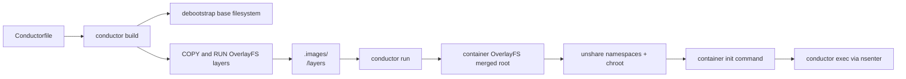

# Architecture

## Overview

Conductor is a Bash-based teaching container runtime. It builds a root filesystem, applies Dockerfile-like filesystem changes as OverlayFS layers, then starts a command inside isolated Linux namespaces and a `chroot` environment.

## Components

### Image builder

`build` reads the first `FROM` instruction, maps the distribution and version to a configured Debian or Ubuntu mirror, and uses `debootstrap` to populate a cached base root filesystem.

It then processes `COPY` and `RUN` lines in order. Each instruction has a content-derived SHA-256 layer key. Existing layer directories are reused as a local build cache.

For `RUN`, Conductor mounts an OverlayFS filesystem, mounts `proc` and `sysfs`, bind-mounts `/dev`, executes the command through `chroot`, then records the changed files in that layer's `diff` directory.

### Layer and image storage

All runtime state is created alongside `task3/conductor.sh` (or through its symlink in Task 4):

| Location | Contents |
| --- | --- |
| `.cache/base/<distro-version>` | `debootstrap` base root filesystem. |
| `.cache/layers/<hash>/diff` | Files changed by a `COPY` or `RUN` instruction. |
| `.cache/layers/<hash>/work` | OverlayFS work directory. |
| `.cache/layers/<hash>/metadata` | Original `COPY` or `RUN` instruction. |
| `.cache/layers/<hash>/parent` | Parent layer hash. |
| `.images/<image>/layers` | Colon-separated OverlayFS lower-directory stack. |
| `.containers/<container>/upper` | Writable files created by a running container. |
| `.containers/<container>/work` | OverlayFS work directory for that container. |
| `.containers/<container>/merged` | The mounted root filesystem used by the container. |

Images are metadata plus references to the cached layers; they are not portable image archives.

### Runtime isolation

`run` mounts the image's lower layers with a new writable upper layer. It bind-mounts host `/dev` into the container root, then launches `unshare` with fresh:

- UTS namespace (hostname isolation)
- PID namespace (process-ID isolation)
- network namespace
- mount namespace
- IPC namespace

Inside those namespaces it mounts `proc` and `sysfs`, changes root with `chroot`, and executes the requested init command. `--fork` gives the container process its own PID namespace child, and `--kill-child` requests child cleanup when the launcher exits.

`exec` discovers the running container process, enters its namespaces with `nsenter`, and runs the requested command after `chroot`ing to its merged root filesystem.

### Networking

`addnetwork` exposes the container network namespace to `iproute2` through a temporary `/var/run/netns/<container>` symlink. It then:

1. creates a veth pair named `<container>-outside` and `<container>-inside`;
2. moves the inside interface into the container namespace;
3. assigns a generated `192.168.x.1/24` host address and `192.168.x.2/24` container address;
4. enables the interfaces and loopback;
5. adds routing between host and container;
6. optionally configures NAT and forwarding rules for Internet access;
7. optionally configures DNAT to forward a host TCP port to the container.

`peer` allows forwarding directly between the host-side veth interfaces of two named containers.

## Trust boundary

Conductor must run as root and directly uses host mounts, namespaces, `/proc`, `/dev`, network forwarding, and `iptables`. It is a learning tool, not a security boundary suitable for untrusted workloads.
